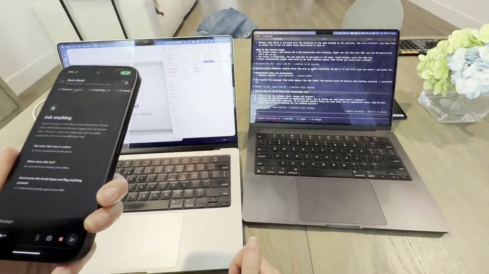

# Gem Mesh

**Open infrastructure for private AI apps on your own devices.** Every gem is a tier node: your phone, your Mac
and, optionally, bigger machines. Gem Mesh makes them act as one system, running Google's Gemma 4 models today on
[LiteRT-LM](https://github.com/google-ai-edge/LiteRT-LM). Your data, your devices, your rules: before any text moves,
your own device checks it for private content and hands it to the smallest device that can do the job. Nothing goes
to a cloud model unless the conversation is public and you approve the exact text.

[](docs/media/gem-mesh-demo.mp4)

*Demo (67 s): a Pixel and two MacBooks on the same Wi-Fi, working as one mesh. Click to play.*

You build the app; the mesh gives it routing, the privacy check, memory, a queue and tools with approval. The repo
ships a reference chat for the Mac and an Android app that exercise all of it. Two example apps show the range: a
**client-safe work assistant** (lease and invoice in, a stamped memo PDF out, nothing leaving the firm) and a
**private companion** (remembers you, edits your photos on the phone).

Status: working prototype. The Mac side is complete; the Android app works and is being tested on real phones; the
iPhone app builds and passes its tests on the simulator, and is next on a real iPhone.

## Get started

| | You need | Time |
|---|---|---|
| [1. Your Mac](#1-your-mac) | Apple silicon (M1 or later), 5 to 25 GB free disk | 10 min + download |
| [2. Your Android phone](#2-your-android-phone) | Android 11+, 8 GB memory recommended, a USB cable | 20 min the first time |
| [iPhone](#iphone) (instead of Android) | iOS 17+, 8 GB memory for E4B (6 GB: E2B), a Mac with Xcode 26 | 30 min the first time |
| [3. A bigger node](#3-optional-a-bigger-node) (optional) | M5 Ultra Mac Studio, Linux with NVIDIA, or any spare Mac | 10 min + download |

The Mac works on its own; add the phone and the bigger node when you want them. All devices on the same Wi-Fi (not a
guest network) find each other by themselves.

### 1. Your Mac

```bash
git clone https://github.com/demobo-com/gem-mesh.git gem-mesh && cd gem-mesh
./install.sh            # shows the plan and download size; press Enter. Ends with "result ok"
gem-mesh              # the chat
```

The installer picks the models that fit your Mac's memory and asks before downloading. It installs
[uv](https://docs.astral.sh/uv/) and Python 3.12 locally (nothing system-wide), puts `gem-mesh` on your PATH
(`~/.local/bin`; it tells you if that needs adding), and makes your Mac a **mesh node**: its model runs as a login
service that your phone and other devices can use.

| Your Mac's memory | Model on the Mac | Photo vision | Download |
|---|---|---|---|
| 32 GB or more | Gemma 4 26B (mixture of experts, 4B active) | E4B | 19.6 GB |
| 24 GB | Gemma 4 12B | E4B | 9.8 GB |
| 16 or 18 GB | Gemma 4 E4B | E4B | 3.8 GB |
| 8 GB | Gemma 4 E2B | E2B | 2.8 GB |

After installing, change the model any time with `gem-mesh model` (shows what is running and what fits) and
`gem-mesh model 12b` (or `26b`, `31b`, `e4b`, `e2b`; downloads it if needed and restarts the node). Use the
installer only once.

Try these in the chat (the files are in `demo/files/`; naming one attaches it):

```
Summarize acme-lease.txt and flag anything unusual
Turn acme-lease.txt and acme-invoice.pdf into a one-page memo called acme-memo.pdf, stamped CONFIDENTIAL
Look at my Milo photos. Which one is best to share?
Brighten the Milo photos, crop them square and take the location off before I share them
My sister Mia lives in Lisbon.            (then later, even offline: Where does Mia live?)
What's the weather in Lisbon right now?
```

The lines above each answer say why it was marked sensitive or public and which device took it; the badge below
says whether anything left the mesh. File changes are shown first and wait for your `y`. In a chat, `/help` lists
the commands. To rehearse without changing the demo files:
`cp -r demo/files /tmp/gem-mesh-files && MESH_FILES_DIR=/tmp/gem-mesh-files gem-mesh`.

### 2. Your Android phone

The app runs Gemma 4 E4B on the phone (E2B with less memory), holds your memory, edits photos on the device, and
sends bigger or private work to your Mac. Attach files from the phone with the paperclip, and talk instead of typing with
the microphone: the phone's own model turns speech into text, so your voice never leaves it. Until there is a release APK, install it over USB:

1. On the Mac, once: `brew install --cask temurin@17 android-platform-tools`, and install
   [Android Studio](https://developer.android.com/studio) once for the Android SDK.
2. On the phone, once: **Settings → About phone →** tap **Build number** seven times; **Developer options → USB
   debugging** on (Xiaomi: also **Install via USB**). Plug it in and accept the prompt; `adb devices` lists it.
3. Install: `cd clients/android && ./gradlew installDebug`.
4. Open **Gem Mesh** on Wi-Fi. It downloads its model (3.7 GB) the first time.
5. **Settings → Your Mac.** The Mac appears by itself on the same Wi-Fi; otherwise run `gem-mesh pair` on the Mac
   and scan its QR code. The tier strip shows the phone and the Mac.

Full guide, with checks to run and fixes for common problems:
[clients/android/README.md](clients/android/README.md).

When the app is released: download the APK from GitHub Releases on the phone (allow "Install unknown apps" once),
open it, and do steps 4 and 5. Google Play later.

### 3. Optional: a bigger node

On a machine with more memory (an M5 Ultra Mac Studio, Linux with NVIDIA GPUs, or a spare Mac), on the same Wi-Fi:

```bash
git clone https://github.com/demobo-com/gem-mesh.git gem-mesh && cd gem-mesh
./install.sh --role workstation      # Linux with NVIDIA is detected without the flag
```

Already installed as a laptop? `gem-mesh role workstation` switches it, and `gem-mesh role laptop` switches it back.

It runs the biggest Gemma 4 that fits its GPU memory as a login service: the 31B on a Mac Studio or an RTX 5090 (two
conversations at once from 48 GB), smaller models on a spare Mac. Your Mac and phone find it; `gem-mesh nodes` on
the Mac lists it, and long or heavy work goes there. Across a VPN, add `http://<address>:9400` under `static_nodes`
in the Mac's profile (`~/.gem-mesh/profile.yaml`).

### iPhone

The same app for iPhone: Gemma 4 E4B on the phone (E2B with 6 GB of memory), your memory, photo edits on the
device, bigger or private work to your Mac. Until it is on TestFlight, install it from Xcode:

1. On the Mac, once: Xcode 26 from the App Store, then
   `sudo xcode-select -s /Applications/Xcode.app/Contents/Developer && sudo xcodebuild -license accept &&
   sudo xcodebuild -runFirstLaunch && xcodebuild -downloadPlatform iOS` (about 8 GB), and sign in to your Apple ID
   in **Xcode → Settings → Accounts**.
2. On the iPhone, once: plug it in, tap **Trust**, and turn on **Settings → Privacy & Security → Developer Mode**.
3. Open `clients/ios/GemmaMesh.xcodeproj`, choose your team under **Signing & Capabilities**, pick the iPhone and
   press **Run**. With a free Apple ID, trust it once in **Settings → General → VPN & Device Management**.
4. Open **Gem Mesh** on Wi-Fi and allow **Local Network**. It downloads its model (3.7 GB) the first time.
5. **Settings → Your Mac.** The Mac appears by itself on the same Wi-Fi; otherwise scan the QR code from
   `gem-mesh pair`.

Full guide, with checks and fixes: [clients/ios/README.md](clients/ios/README.md).

## Commands (on the Mac)

| Command | What it does |
|---|---|
| `gem-mesh` | the chat |
| `gem-mesh ask "..."` · `gem-mesh route "..."` | one answer · where a question would go, without running it |
| `gem-mesh nodes` | the devices in your mesh right now |
| `gem-mesh pair` | connect a phone: address, checks, pairing QR code · `--secure` makes the mesh private, `--open` undoes it |
| `gem-mesh join '<code>'` | put a workstation or another Mac into a paired mesh |
| `gem-mesh role [workstation\|laptop]` | show this machine's role, or switch it |
| `gem-mesh model [12b\|26b\|31b\|e4b\|e2b]` | show this node's model, or switch it (downloads if needed, restarts the node) |
| `gem-mesh memory status\|sync\|recall <q>\|facts\|forget <n>` | your memory; `forget` removes a fact on every device |
| `gem-mesh doctor` | checks profile, model, policy, discovery and the node |
| `gem-mesh models list\|pull <id>` · `gem-mesh plan` | model catalog · what fits this machine |
| `gem-mesh node` | the model server (normally running as the login service `com.gem-mesh.node`) |
| `gem-mesh code` | optional: Claude Code with every model call answered by your mesh (`./install.sh --with-shim`) |

## Security: pairing

Pairing is optional. Without it the mesh is **open**: devices talk plain HTTP, and anyone on the same network can use
your Mac's model and read your phone's memory. Fine on your own hotspot or home network; your risk elsewhere.

`gem-mesh pair --secure` makes it **private**: HTTPS between all devices, a mesh key on every request, and devices
trust only nodes signed by your mesh's own certificate authority, so a fake node on the network gets nothing. Then
pair each phone once by scanning the QR code `gem-mesh pair` shows (it holds the key: show it only to your own
devices), and join a workstation or another Mac with `gem-mesh join '<code>'`. `gem-mesh pair --open` undoes it.
Details: [docs/PROTOCOL.md §6](docs/PROTOCOL.md#6-pairing-and-security). (The Android and iPhone apps are adding
pairing support; until then, keep the mesh open to use them.)

## Make it yours

Everything that decides behaviour is a file in `policy/`:

- `rules.yaml`: patterns and **your own terms** (client names, project names, family names). A hit makes the
  conversation sensitive. Start here.
- `classifier.txt`: the prompt the on-device classifier uses when no rule hits. Unsure counts as sensitive.
- `tiers.yaml`: routing windows, size thresholds, whether the frontier is `ask` or `never`, web access, thinking.
- `models.yaml`: the model catalog and the memory-based sizing.

After changing rules or tiers, run `uv run python eval/make_golden.py` and review the diff of `policy/golden/`. The
Android and iPhone apps bundle `policy/` when they are built, so rebuild them after a change.

## For developers

- How devices find and talk to each other: [docs/PROTOCOL.md](docs/PROTOCOL.md).
- Android: [docs/ANDROID.md](docs/ANDROID.md) (background) and [clients/android/README.md](clients/android/README.md)
  (setup, tests, code map, release). iPhone: [docs/IOS.md](docs/IOS.md) (background) and
  [clients/ios/README.md](clients/ios/README.md) (setup, tests, simulator, code map).
- No phone at hand: `./install.sh --dev` adds `gem-mesh-mobile`, a phone stand-in that runs the phone's model on
  the Mac and holds memory the way the app does.
- Tests: `uv run python eval/test_router.py`, `uv run python eval/test_golden.py`; with models installed,
  `scripts/e2e-actions.sh` (file and photo actions, about 2 minutes); Android: `cd clients/android && ./gradlew test`;
  iPhone: `cd clients/ios/Kit && swift test`, and the UI tests with `xcodebuild test` (see its README).

```
core/             meshcore: discovery (mDNS), router, policy, profiles, memory and sync, LiteRT-LM engine
servers/litert/   the node server: OpenAI-compatible chat completions over LiteRT-LM, with tools and session reuse
clients/cli/      gem-mesh: the Mac chat, file and photo actions, web, operator tools, optional Claude Code shim
clients/android/  the Android app (Kotlin, Compose, LiteRT-LM)
clients/ios/      the iPhone app (Swift, SwiftUI, LiteRT-LM)
policy/           rules, classifier prompt, tiers, model catalog, golden test cases
demo/files/       demo documents and photos
docs/             protocol, Android and iPhone developer guides
eval/             router and golden tests, classifier and tool-call evaluations
scripts/          install.sh and end-to-end checks (e2e-*.sh, phone-client-check.py)
static/           the project's pitch deck and plan (served as a static site)
```

## Uninstall

On a Mac:

```bash
launchctl bootout gui/$(id -u)/com.gem-mesh.node; rm ~/Library/LaunchAgents/com.gem-mesh.node.plist
rm -f ~/.local/bin/gem-mesh ~/.local/bin/gem-mesh-mobile ~/.local/bin/mesh ~/.local/bin/meshnode
rm -rf ~/.gem-mesh          # profiles, memory, queue, logs
rm -rf ~/.litert-lm/models    # downloaded models (shared with other LiteRT-LM tools, if you use any)
```

On Linux: `systemctl --user disable --now gem-mesh-node.service` and remove
`~/.config/systemd/user/gem-mesh-node.service`, then the same `rm` lines. On Android or iPhone: delete the app (its
model and memory go with it).

## License

Code: Apache License 2.0 (see `LICENSE`). The Gemma models are downloaded separately and are governed by the
[Gemma Terms of Use](https://ai.google.dev/gemma/terms) and the Gemma Prohibited Use Policy; you accept them by
downloading the models. Gem Mesh is an independent project, not affiliated with Google.
